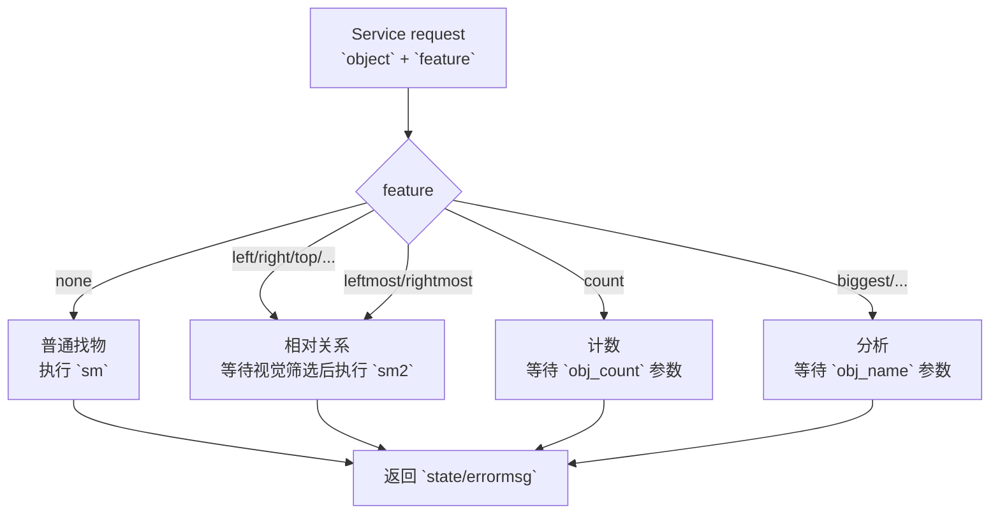

# `seu_look_for_object` 现状分析报告

## 🔎 分析范围

本次分析对应你提到的 `seu_find_object`。在当前工作区中，没有名为 `seu_find_object` 的 ROS 包；实际存在并承担找物功能的是 `GPSR_code/src/seu_look_for_object`。因此本报告基于 `seu_look_for_object` 当前代码进行分析。

本报告覆盖以下内容：

- 代码结构与职责划分
- 实际技术路线与运行链路
- 上层调用方法与调试方式
- 状态机与消息/参数设计
- 当前能力边界
- 存在的问题与优先级判断

## 🧭 包定位

`seu_look_for_object` 本质上是一个 ROS1 找物服务包，用于给 GPSR 总状态机提供“找物 / 找相对物 / 计数 / 部分物品分析”的能力。

从代码看，它不是一个纯视觉包，而是一个混合式任务包，内部同时包含：

- 感知入口：相机节点 + 目标检测 + 深度转三维坐标
- 任务编排：服务回调 + SMACH 状态机
- 机器人执行：直接发布 `/cmd_vel` 控制底盘转向与前进
- 结果输出：ROS Service 返回成功失败，详细结果则旁路写入 ROS Param

## 🗂️ 代码结构

| 文件 | 角色 | 当前状态 |
| --- | --- | --- |
| `scripts/find_object.py` | 找物主服务节点，负责服务入口、状态机、底盘朝向与接近目标 | 运行主入口 |
| `scripts/yolov7/find_object_camera_2025.py` | 相机侧处理节点，负责开关相机、检测、计数、关系分析、发布 `/find_object_result` | 运行主入口 |
| `srv/seu_findobject.srv` | 服务接口定义 | 真实接口 |
| `README.md` | 包说明与调试说明 | 明显过期 |
| `scripts/yolov7/yolo.py` | 一套本地 YOLOv7 推理实现 | 当前基本未接入主流程 |
| `GPSR_code/src/common/camera.py` | 通用相机/检测工具，内含 `Camera` 和 `ObjDetect` | 当前真实检测实现来自这里 |
| `GPSR_code/src/seu_smach_main/scripts/gpsr_smach.py` | 上层 GPSR 状态机，对本包服务发起调用 | 上层调用入口 |

## 🏗️ 实际技术路线

当前运行时的真实技术路线，不是 README 所描述的“本包内部 YOLOv7 闭环”，而是：

1. `gpsr_smach.py` 调用 `find_object_service`
2. `find_object.py` 接收服务请求，写入 `obj_target` / `obj_feature`
3. `find_object_camera_2025.py` 读取这些 ROS Param，驱动视觉分析
4. `find_object_camera_2025.py` 通过 `common.camera.Camera` 获取 RealSense 图像和深度
5. `find_object_camera_2025.py` 通过 `common.camera.ObjDetect` 做检测
6. `ObjDetect` 实际调用的是 `common/camera.py` 中基于 `ultralytics.YOLO` 的模型，而不是本包 `scripts/yolov7/yolo.py`
7. 检测结果通过 `/find_object_result` 回到 `find_object.py`
8. `find_object.py` 再通过 TF 将相机系坐标转为 `map` 系，并驱动状态机控制底盘

```mermaid
flowchart LR
    accTitle: seu_look_for_object Real Runtime Pipeline
    accDescr: GPSR upper state machine calls the object service, which coordinates a camera node through ROS params and topics, while actual detection is performed by common.camera using a YOLO model.

    upper["`seu_smach_main/gpsr_smach.py`"]
    srv["`find_object.py`\nROS Service server"]
    params["ROS Params\n`obj_target` / `obj_feature` / `obj_name` / `obj_count` / `obj_pos`"]
    cam["`find_object_camera_2025.py`"]
    common["`common/camera.py`\n`Camera` + `ObjDetect`"]
    detect["Ultralytics YOLO model\n`common/models/epoch10.pt`"]
    topic["Topic `/find_object_result`"]
    tfnav["TF transform + SMACH + `/cmd_vel`"]

    upper --> srv
    srv --> params
    params --> cam
    cam --> common
    common --> detect
    cam --> topic
    topic --> srv
    srv --> tfnav
```

### 关键结论

- 名义目录叫 `yolov7`，但当前主路径实际上依赖 `common/camera.py` 里的 `ObjDetect`
- 当前真实检测模型是 `common/models/epoch10.pt`
- `scripts/yolov7/yolo.py` 更像历史遗留代码或备用实现，而不是当前主链路

## 🔌 实际调用接口

### 1. ROS Service

真实服务定义见 `srv/seu_findobject.srv`：

```srv
string object
string feature
---
bool state
string errormsg
```

这和 README 中只写 `string object` 明显不一致。`feature` 目前是整个功能分支的关键控制量。

### 2. 上层调用方式

上层 GPSR 通过 `gpsr_smach.py` 中的 `LookForObjState` 调用该服务：

- 服务名：`find_object_service`
- 请求字段：
  - `object`: 目标物体名或类别
  - `feature`: 查找模式或关系模式

典型特征值包括：

- `none`：普通找物
- `count`：计数
- `biggest` / `largest` / `smallest` / `heaviest` / `lightest` / `thinnest`
- `left` / `right` / `top` / `above` / `behind` / `under`
- `leftmost` / `rightmost`

### 3. 手工调试调用

README 里给出的命令：

```bash
rosservice call /find_object_service "object: 'fan'"
```

与真实 `.srv` 不匹配。至少应当补齐 `feature` 字段，例如：

```bash
rosservice call /find_object_service "object: 'lays'
feature: 'behind'"
```

或者普通找物：

```bash
rosservice call /find_object_service "object: 'cola'
feature: 'none'"
```

## 🔄 功能模式拆解

### 1. 普通找物：`feature == none`

`find_object.py` 走 `sm` 状态机：

- `EXPLORE_ROOM`
- `FACE_TO_OBJECT`
- `MOVE_TO_OBJECT`

这个流程的本质是：边旋转边等视觉回传目标，发现后转向，再向前接近。

### 2. 相对关系找物：`left/right/top/above/behind/under`

先由相机节点做一轮关系分析，选出满足关系的目标，再进入 `sm2`：

- `FACE_TO_OBJECT`
- `MOVE_TO_OBJECT`

也就是说，相对关系模式是“先视觉筛对象，再导航对齐/接近”。

### 3. 极值位置找物：`leftmost/rightmost`

相机节点直接在每帧所有目标里选最左/最右，再统计多数票，最后发布结果。

### 4. 计数：`count`

相机节点在 10 秒窗口内统计每帧目标个数，返回出现频率最高的计数值。

### 5. 物品分析：`biggest/largest/smallest/heaviest/lightest/thinnest`

代码表面支持这些特征，但实际并没有真正完成这些语义，后文会详细说明。

## 🧠 状态机与数据通路



### 当前数据通路的特点

- 控制命令：通过 topic `/findobject_camera_state`
- 检测结果：通过 topic `/find_object_result`
- 真正的“返回值”：大量通过 ROS Param 旁路传递
  - `obj_target`
  - `obj_feature`
  - `obj_name`
  - `obj_count`
  - `obj_pos`

这意味着它并不是一个“service request -> service response”的闭环接口，而是一个 service + topic + param 的混合协议。

## 📌 代码层面的关键观察

### 1. 主服务节点 `find_object.py`

`find_object.py` 的核心职责有三类：

- 接收服务请求并分流
- 订阅 `/find_object_result` 获取目标物体三维坐标
- 通过 SMACH 状态机控制底盘旋转与前进

几个关键实现点：

- 在模块加载阶段就立即 `rospy.init_node('FIND_OBJECT')`
- 启动时等待 `move_base` action server，但后续并未真正使用 `move_base`
- 实际运动控制全部通过 `/cmd_vel`
- `ps_out`、`object`、`feature` 都是全局共享变量

### 2. 相机节点 `find_object_camera_2025.py`

这个文件名虽然在 `yolov7` 目录下，但实际做法是：

- `sys.path.append("/home/syw/code/robocup_nation/2024code/GPSR/src")`
- `from common.camera import *`

所以它真正依赖的是外部 `common.camera`，而不是当前目录的 `yolo.py`。

### 3. 实际检测器 `common/camera.py`

`common/camera.py` 中：

- `Camera` 封装 RealSense 采集
- `ObjDetect` 使用 `ultralytics.YOLO`
- 模型路径是 `common/models/epoch10.pt`

这说明运行时技术路线已经转成了“RealSense + Ultralytics YOLO”，而不是包内 README 所说的 YOLOv7 模型文件加载路线。

## ⚠️ 存在的问题

下面按影响程度排序。

### 高优先级问题

| 问题 | 证据 | 影响 |
| --- | --- | --- |
| 包名与文档命名不一致 | 仓库中实际是 `seu_look_for_object`，没有 `seu_find_object`；README 又混用 `look_for_object` / `find_object` | 容易让维护者、调用方和文档使用者搞错真实入口 |
| README 与真实接口不一致 | README 的服务说明缺少 `feature`；启动文件名写 `find_object_camera.py`，实际文件是 `find_object_camera_2025.py` | 直接导致调试命令和集成说明失效 |
| 技术路线分裂 | `find_object_camera_2025.py` 走 `common.camera.ObjDetect`，而 `scripts/yolov7/yolo.py` 无调用方 | 包内名义实现与实际运行实现不是同一套，维护成本高，容易误改 |
| 硬编码路径不可移植 | `find_object.py:1`、`find_object_camera_2025.py:1` 使用 `/home/syw/anaconda3/envs/GPSR/bin/python`；`find_object_camera_2025.py:13` 写死 `/home/syw/code/.../GPSR/src`；`scripts/yolov7/yolo.py:15-18` 也写死 `/home/syw/...` 模型路径 | 换机器、换用户名、换工作区后大概率直接启动失败 |
| “biggest/smallest/heaviest/lightest/thinnest” 未真实实现 | `find_object_camera_2025.py:125-143` 的 `do_analyse()` 只统计标签出现次数，并未计算面积、体积、重量或细长程度 | 这类指令语义上是假的，返回结果与命令含义不一致 |
| `leftmost/rightmost` 没有使用目标类别过滤 | `find_object_camera_2025.py:233-288` 的 `do_pos_most()` 完全没有使用传入的 `object` 参数 | 查询“最左边的某类物体”时会退化成“全场最左边的任意物体” |
| 服务接口设计不完整 | `.srv` 返回只有 `bool state` 和 `string errormsg`，真实结果却放进 `obj_name/obj_count/obj_pos` 等 ROS Param | 接口隐式耦合严重，不利于复用、调试和并发 |
| 包依赖声明不完整 | `package.xml` 只声明了 `roscpp/rospy/std_msgs/message_generation/message_runtime`，但代码实际使用 `geometry_msgs`、`sensor_msgs`、`move_base_msgs`、`actionlib`、`tf2_ros`、`smach`、`seu_robot_msgs`、`cv_bridge` 等 | 新环境编译/运行很容易缺依赖，包元数据不可信 |
| 启动集成被注释掉 | `seu_smach_main/launch/init.launch:11-17` 与 `export.launch:2-3` 中相关节点都被注释 | 整体系统默认并不会把这个包真正拉起 |

### 中优先级问题

| 问题 | 证据 | 影响 |
| --- | --- | --- |
| 脚本不可直接执行 | 两个主脚本权限均为 `664`，且 `CMakeLists.txt:162-167` 的 `catkin_install_python` 被注释 | `rosrun`/安装部署路径不稳定 |
| 启动时无条件等待 `move_base`，但后续不用 | `find_object.py:29-33` 创建并等待 `move_base`，全文件没有实际调用 | 增加无意义启动依赖，拖慢甚至阻塞启动 |
| 导航控制过于原始 | `FaceToObject` 和 `MoveToObject` 都直接发 `/cmd_vel`，没有避障、没有路径规划、没有闭环位置容错 | 实机稳定性较差，容易受噪声、漂移和障碍物影响 |
| `MoveToObject` 没有真正的 timeout 分支 | `MoveToObject.execute()` 声明了 `success/timeout`，但实际只返回 `success` | 状态机转移设计与实现不一致 |
| TF 变换缺少异常处理 | 多处直接 `buffer.transform(ps, "map")`，无 `try/except` | TF 未准备好时节点可能直接抛异常 |
| 全局变量过多，接口不可重入 | `object`、`feature`、`ps_out` 为全局共享；Service 又依赖 ROS Param 共享状态 | 多请求并发、重入调用、故障恢复都不安全 |
| 类别词表与上层规划不完全一致 | `is_target_kind()` 只认 `food/drink/cleaning stuff`；上层计划里有 `snack`、`cleaning supply`；类别文件里还有 `orange_juice` 但 `drink_list` 未覆盖 | 某些自然语言任务在上层能规划，下层却不能正确识别和归类 |

### 低优先级问题

| 问题 | 证据 | 影响 |
| --- | --- | --- |
| 存在明显遗留代码和无用导入 | `find_object.py` 中的 `pybullet_examples.jacobian.result`、`sympy.false`、`LaserScan`、`MoveBaseGoal` 等未实际使用 | 增加阅读负担，降低代码可信度 |
| `package.xml` 元数据未完善 | `license` 仍是 `TODO` | 工程规范性不足 |
| README 自述与当前目录不一致 | README 仍描述 `find_object_camera.py`、YOLOv7 模型加载等旧路线 | 文档进一步失真 |

## 🎯 当前能力边界判断

以“当前代码真实能力”而不是“接口宣称能力”来评估：

| 功能 | 当前判断 |
| --- | --- |
| 普通找某个具体物体 | 基本可用，但依赖视觉稳定、TF 正常和场地简单 |
| 找某类物体（如 food / drink / cleaning stuff） | 有一定可用性，但类目词表较死 |
| 相对关系找物（left/right/top/behind/under） | 可部分工作，但目标选择逻辑较脆弱 |
| 计数 | 有一定可用性，属于时间窗投票计数 |
| leftmost/rightmost | 仅支持“全场最左/最右”，不支持“某类中的最左/最右” |
| biggest/largest/smallest/heaviest/lightest/thinnest | 目前基本不可认为真实实现 |

## 🛠️ 建议的整改优先级

### P0：先让系统“可维护、可部署、可解释”

1. 去掉所有硬编码绝对路径，改用 ROS 包路径或相对路径
2. 统一真实技术路线
   - 要么彻底收敛到 `common.camera`
   - 要么彻底收敛到包内 `yolov7`
   - 不要继续双轨并存
3. 修正 `README.md`、launch、service 示例命令
4. 完整补齐 `package.xml` 和 `CMakeLists.txt` 依赖与安装项

### P1：再让接口“真正表达能力”

1. 重设计服务返回值
   - 不要只返回 `bool`
   - 至少应显式返回 `obj_name / obj_count / obj_pos`
2. 将 `count`、`analyze`、`find` 拆成清晰接口，避免 feature 字符串过载
3. 去掉对 ROS Param 的强耦合旁路依赖

### P2：最后补算法语义和实机稳定性

1. 真正实现 `biggest/smallest` 等语义
   - 例如基于框面积、深度归一化尺寸、形状特征
2. `leftmost/rightmost` 增加目标类别过滤
3. `MoveToObject` 改成真正闭环控制，或直接走 `move_base`
4. 给 TF、相机、检测器增加异常保护和超时处理

## ✅ 总结

`seu_look_for_object` 现在的状态不是“不能用”，而是“能跑一部分流程，但工程形态不稳定、文档过期、接口设计混乱、宣称能力大于真实能力”。

最核心的判断有三点：

1. 当前真实运行链路已经不是 README 所描述的那一套
2. 这个包的 service 只是外壳，真正的数据传递严重依赖 ROS Param 旁路
3. `biggest/heaviest/...` 这类高级语义目前并没有真实落地

如果只是为了短期比赛演示，普通找物、相对位置找物、计数这三类功能还可以继续围绕当前代码打补丁；如果目标是长期维护或稳定集成，建议尽快做一次“接口收敛 + 依赖清理 + 文档重写 + 语义能力重构”。
