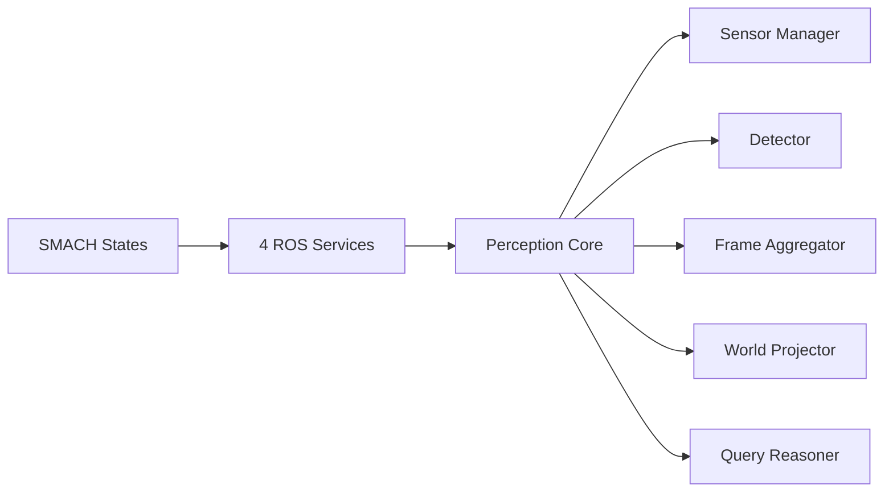
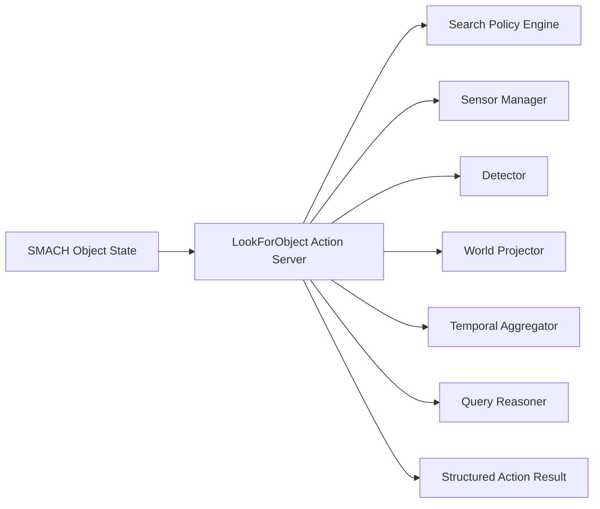

# `seu_look_for_object` 重写接口与架构设计（方案 B / 方案 C）

## 🎯 设计目标

这份文档从主状态机 `seu_smach_main` 的视角出发，定义重写后的 `look_for_object` 模块应当提供什么能力，以及两种完全优化架构的具体设计：

- **方案 B**：多服务拆分架构
- **方案 C**：Action 中心架构

本设计默认不再兼容旧实现中的以下问题：

- 不再使用 ROS Param 作为结果旁路
- 不再把计数、分析、关系查询混在一个弱类型 `feature` 字符串里
- 不再让视觉节点直接承担不清晰的执行逻辑
- 不再让 `grasp`、`info_inform` 依赖隐式全局状态

## 🧭 主状态机对该模块的真实需求

从 [gpsr_smach.py](/home/duo/GPSR_ws_zyd/GPSR_code/src/seu_smach_main/scripts/gpsr_smach.py#L659)、[plan_set_2025.json](/home/duo/GPSR_ws_zyd/GPSR_code/src/seu_llm/scripts/plan_sets/plan_set_2025.json#L7) 和 [info_inform_service.py](/home/duo/GPSR_ws_zyd/GPSR_code/src/seu_info_inform/scripts/info_inform_service.py#L229) 反推，主状态机对该模块有四类稳定需求：

| 需求类型 | 示例 | 主状态机真正需要的结果 |
| --- | --- | --- |
| 普通找物 | `look_for_obj orange_juice none` | 目标是否存在；若后续要抓取，还要有目标位姿 |
| 关系找物 | `look_for_obj lays behind` | 某个满足关系的目标标签和位姿 |
| 计数 | `look_for_obj snack count` | 一个稳定的整数结果 |
| 属性分析 | `look_for_obj cleaning_supply biggest` | 一个可播报、可引用的解析结果标签 |

因此，重写后的模块必须满足两个硬要求：

1. **同步给出结构化结果**
2. **结果能直接进入 SMACH userdata，而不是落到 ROS Param**

## 📦 统一领域模型

不管选方案 B 还是方案 C，都建议先统一内部和外部的数据模型。

### 1. 统一查询模型

建议内部统一抽象为：

| 字段 | 类型 | 说明 |
| --- | --- | --- |
| `query_id` | `string` | 请求唯一 ID，便于跟踪 |
| `query_mode` | `enum` | `FIND` / `RELATE` / `COUNT` / `ANALYZE` |
| `target_class` | `string` | 目标物体类别或物体名 |
| `reference_class` | `string` | 关系查询中的参考物，如 `lays` |
| `relation` | `enum` | `LEFT_OF` / `RIGHT_OF` / `ABOVE` / `BEHIND` / `LEFTMOST` / `RIGHTMOST` |
| `metric` | `enum` | `BIGGEST` / `SMALLEST` / `HEAVIEST` / `LIGHTEST` / `THINNEST` |
| `search_scope` | `string` | 当前搜索区域，如 `cabinet`、`bedroom`，由上层传入 |
| `timeout_sec` | `float` | 超时 |
| `need_pose` | `bool` | 是否需要输出位姿 |
| `min_confidence` | `float` | 最低置信度阈值 |

### 2. 统一目标结果模型

建议新增一个统一消息，例如 `ObjectDetectionResult.msg`：

| 字段 | 类型 | 说明 |
| --- | --- | --- |
| `label` | `string` | 标准化标签 |
| `score` | `float32` | 目标置信度 |
| `pose` | `geometry_msgs/PoseStamped` | map 坐标系下位姿 |
| `bbox` | `float32[4]` | 图像框 `x1 y1 x2 y2` |
| `distance` | `float32` | 距离机器人距离 |
| `source_frame` | `string` | 原始检测坐标系 |

### 3. 统一查询输出模型

建议所有接口最终都能映射成一套统一输出：

| 字段 | 类型 | 说明 |
| --- | --- | --- |
| `success` | `bool` | 是否成功 |
| `status_code` | `string` | `OK` / `NOT_FOUND` / `TIMEOUT` / `AMBIGUOUS` / `INVALID_QUERY` |
| `message` | `string` | 可读错误或说明 |
| `selected_object` | `ObjectDetectionResult` | 主结果对象 |
| `candidate_objects` | `ObjectDetectionResult[]` | 候选列表 |
| `count` | `int32` | 计数结果 |
| `resolved_label` | `string` | 关系查询或分析查询解析后的最终标签 |

## 🔄 查询模式定义

建议把旧的 `feature` 字符串拆成明确模式。

| 模式 | 输入 | 输出 | 下游依赖 |
| --- | --- | --- | --- |
| `FIND` | `target_class` | `selected_object` | `grasp`、`put_on` |
| `RELATE` | `reference_class + relation` | `resolved_label + selected_object` | `grasp`、`deliver` |
| `COUNT` | `target_class` | `count` | `info_inform` |
| `ANALYZE` | `target_class + metric` | `resolved_label`，必要时附 `selected_object` | `info_inform` |

## 🅱️ 方案 B：多服务拆分架构

### 方案定义

方案 B 的核心思想是：**保留 SMACH 作为同步编排层，但把物体查询拆成多个语义清晰的 ROS Service**。

主状态机仍然是任务总控，但不再只调用一个“大杂烩 find_object_service”，而是根据动作类型调用不同服务。

### 外部接口设计

建议提供以下 4 个服务。

| 服务名 | 用途 | 建议输入 | 建议输出 |
| --- | --- | --- | --- |
| `find_object_service` | 普通找物 | `target_class, search_scope, timeout_sec, need_pose` | `success, selected_object, message` |
| `relate_object_service` | 关系查询 | `reference_class, relation, search_scope, timeout_sec, need_pose` | `success, resolved_label, selected_object, message` |
| `count_object_service` | 计数 | `target_class, search_scope, timeout_sec` | `success, count, candidate_objects, message` |
| `analyze_object_service` | 属性分析 | `target_class, metric, search_scope, timeout_sec` | `success, resolved_label, selected_object, message` |

### 模块划分

### 内部子模块

| 子模块 | 输入 | 输出 | 责任 |
| --- | --- | --- | --- |
| `sensor_manager` | 相机流、TF | 同步后的 RGBD 帧 | 采集与时间同步 |
| `detector` | RGB 帧 | 原始 2D 检测列表 | 目标检测 |
| `projector` | 2D 框、深度、TF | `ObjectDetectionResult` 列表 | 投影到 map 坐标 |
| `frame_aggregator` | 多帧 `ObjectDetectionResult` | 稳定候选集 | 去噪、跟踪、投票 |
| `query_reasoner` | 查询请求 + 候选集 | 查询结果 | 普通查找、关系、计数、分析 |

### 每个子功能的信息传递

#### 1. 普通找物

| 阶段 | 输入 | 输出 |
| --- | --- | --- |
| SMACH -> `find_object_service` | `target_class, search_scope, timeout_sec, need_pose` | 服务请求 |
| service -> `sensor_manager` | 请求上下文 | 时间窗内连续 RGBD 帧 |
| `detector` -> `projector` | 2D 检测框 | 带 map 位姿的候选对象 |
| `frame_aggregator` -> `query_reasoner` | 稳定候选对象集 | 最终选择对象 |
| service -> SMACH | `success + selected_object` | 写入 userdata，如 `userdata.object_result` |

#### 2. 关系找物

| 阶段 | 输入 | 输出 |
| --- | --- | --- |
| SMACH -> `relate_object_service` | `reference_class, relation, search_scope` | 服务请求 |
| `query_reasoner` | 稳定候选对象集 | 参考物对象 + 满足关系的目标对象 |
| service -> SMACH | `resolved_label + selected_object` | userdata 中保存可抓取结果 |

#### 3. 计数

| 阶段 | 输入 | 输出 |
| --- | --- | --- |
| SMACH -> `count_object_service` | `target_class, search_scope, timeout_sec` | 服务请求 |
| `frame_aggregator` | 多帧候选对象 | 去重后的稳定数量 |
| service -> SMACH | `count` | userdata 中保存 `object_count` |

#### 4. 属性分析

| 阶段 | 输入 | 输出 |
| --- | --- | --- |
| SMACH -> `analyze_object_service` | `target_class, metric, search_scope` | 服务请求 |
| `query_reasoner` | 候选对象集 | 排序结果 |
| service -> SMACH | `resolved_label`，必要时附对象位姿 | userdata 中保存 `resolved_label` |

### 对主 SMACH 的影响

方案 B 不要求推翻主状态机，只要求：

- 把 `LookForObjState` 拆成 4 个状态，或保留一个 facade 状态后内部路由到 4 个服务
- `grasp` 不再读 `obj_pos` ROS Param，而是直接读 `userdata.object_result`
- `info_inform` 不再读 `obj_name/obj_count` ROS Param，而是读 `userdata.object_query_result`

这属于 **中等改动**，不是大改总状态机，只是 object 相关状态和结果传递方式要重写。

### 方案 B 的优点

- 语义清晰
- 易于单元测试
- 每个服务职责边界明确
- 适合比赛型系统逐步替换

### 方案 B 的缺点

- 接口数量更多
- 长时间查询没有天然 feedback
- 若以后加入“可取消搜索”，service 不如 action 自然

## 🅲 方案 C：Action 中心架构

### 方案定义

方案 C 的核心思想是：**把所有 object 查询收敛成一个长时运行的 Action Server**，让主状态机把它当作“可反馈、可超时、可取消”的任务执行器。

这个方案里，“第二个是什么意思”可以直接理解成：

- 不是整个主 SMACH 必须重写
- 但 object 相关状态必须从 `ServiceProxy` 改成 `ActionClient`
- 数据返回要走 `result` 和 `userdata`，不再走 ROS Param

也就是说，**主 SMACH 需要改，但只是 object 子链路中等偏大的改动，不是推翻整个状态机框架**。

### 外部接口设计

建议定义一个统一 action，例如 `LookForObject.action`。

#### Goal

| 字段 | 类型 | 说明 |
| --- | --- | --- |
| `query_id` | `string` | 请求 ID |
| `query_mode` | `uint8` | `FIND / RELATE / COUNT / ANALYZE` |
| `target_class` | `string` | 查询目标 |
| `reference_class` | `string` | 关系参考目标 |
| `relation` | `uint8` | 关系类型 |
| `metric` | `uint8` | 分析指标 |
| `search_scope` | `string` | 当前搜索区域 |
| `timeout_sec` | `float32` | 超时 |
| `need_pose` | `bool` | 是否要求位姿 |
| `min_confidence` | `float32` | 置信度阈值 |

#### Feedback

| 字段 | 类型 | 说明 |
| --- | --- | --- |
| `stage` | `string` | `SCANNING / DETECTING / REASONING / CONFIRMING` |
| `elapsed_sec` | `float32` | 已耗时 |
| `frames_processed` | `int32` | 已处理帧数 |
| `candidate_count` | `int32` | 当前候选数 |
| `current_best_label` | `string` | 当前最佳候选 |

#### Result

| 字段 | 类型 | 说明 |
| --- | --- | --- |
| `success` | `bool` | 是否成功 |
| `status_code` | `string` | 状态码 |
| `message` | `string` | 错误说明或摘要 |
| `selected_object` | `ObjectDetectionResult` | 主结果对象 |
| `candidate_objects` | `ObjectDetectionResult[]` | 候选列表 |
| `count` | `int32` | 计数结果 |
| `resolved_label` | `string` | 解析后标签 |

### 架构划分

### 每个子功能的信息传递

#### 1. 普通找物

| 阶段 | 输入 | 输出 |
| --- | --- | --- |
| SMACH -> action goal | `query_mode=FIND, target_class, search_scope, need_pose` | Action Goal |
| action server -> perception core | Goal 上下文 | 候选对象流 |
| `track + query_reasoner` | 多帧候选对象 | 稳定主对象 |
| action result -> SMACH | `selected_object` | userdata 保存可抓取对象 |

#### 2. 关系找物

| 阶段 | 输入 | 输出 |
| --- | --- | --- |
| goal | `query_mode=RELATE, reference_class, relation` | Action Goal |
| `query_reasoner` | 候选对象图 | 关系解析结果 |
| result | `resolved_label + selected_object` | userdata 保存对象和名称 |

#### 3. 计数

| 阶段 | 输入 | 输出 |
| --- | --- | --- |
| goal | `query_mode=COUNT, target_class` | Action Goal |
| `track` | 多帧目标列表 | 去重目标集合 |
| result | `count` | userdata 保存计数 |

#### 4. 属性分析

| 阶段 | 输入 | 输出 |
| --- | --- | --- |
| goal | `query_mode=ANALYZE, target_class, metric` | Action Goal |
| `query_reasoner` | 候选对象集 | 排序后的主对象和标签 |
| result | `resolved_label`，可附 `selected_object` | userdata 保存播报结果 |

### 搜索策略能力

Action 架构相比多服务最大的增益，是可以显式建模搜索策略：

| 能力 | 说明 |
| --- | --- |
| 超时 | Action 原生支持 |
| 取消 | 上层可 preempt |
| 反馈 | 主状态机或 UI 可看到当前进度 |
| 分阶段控制 | 例如“先扫视，再精检，再确认” |
| 长时任务 | 适合实机搜索而不是纯瞬时查询 |

### 对主 SMACH 的影响

主 SMACH 不需要完全重写，但 object 相关链路要明显调整：

- `LookForObjState` 改成 action client
- `ObjAnalyzeState` 和 `ObjCountState` 可以并入一个通用 object query state，或继续保留为不同 state 但内部都发 action
- `grasp` 和 `info_inform` 改为读取 userdata 中的 action result
- 若要利用 feedback，还可以在 object state 内根据反馈做超时、重试、切视角

这属于 **中等偏大改动**。不是“主 SMACH 全部重写”，但 object 查询这一支的调用方式、结果结构和后续消费方式都要重构。

### 方案 C 的优点

- 适合长时搜索
- 天然支持进度反馈与取消
- 可以把“搜索策略”作为一等公民建模
- 更适合后续扩展成真实任务执行器

### 方案 C 的缺点

- 对现有 SMACH object 子链路改动更大
- 调试复杂度更高
- 第一版实现成本高于方案 B

## ⚖️ 方案对比

| 维度 | 方案 B | 方案 C |
| --- | --- | --- |
| 接口风格 | 多服务 | 单 Action |
| 语义清晰度 | 很高 | 高 |
| 长时搜索支持 | 一般 | 很强 |
| 反馈与取消 | 弱 | 强 |
| 主 SMACH 改动 | 中等 | 中等偏大 |
| 开发复杂度 | 中等 | 较高 |
| 调试难度 | 较低 | 较高 |
| 比赛快速落地 | 更适合 | 次之 |
| 后续扩展空间 | 高 | 很高 |

## 🧩 推荐落地方式

如果你要“完全优化架构”，但又不想把第一版重构成本拉得过高，建议按下面顺序推进：

1. 先按 **方案 B** 做领域模型和结果传递收敛
2. 去掉 ROS Param 旁路，统一改成结构化 result + userdata
3. 等语义和模块边界稳定后，再考虑升级到 **方案 C**

如果你确定后续要做：

- 多视角搜索
- 中途取消
- 过程反馈
- 复杂重试策略

那可以直接上 **方案 C**。

## ✅ 结论

### 如果你选方案 B

你得到的是：

- 一个语义清晰的 object 子系统
- 多服务接口
- 对主 SMACH 中等改动
- 最适合当前仓库从旧实现平滑重写

### 如果你选方案 C

你得到的是：

- 一个任务执行器式 object 子系统
- Action 中心接口
- 主 SMACH 的 object 子链路需要重构，但不需要推翻整套 SMACH
- 最适合把找物能力做成长期可扩展基础设施

### 关于“方案 C 是不是主 SMACH 要大改”

答案是：

- **不是整个主 SMACH 全部大改**
- **是 object 相关状态和结果传递方式要明显改**

如果只看全局任务框架，SMACH 还能继续保留。
如果只看 object 这一支，方案 C 的确比方案 B 改动大不少。
