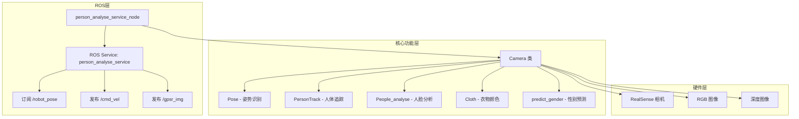
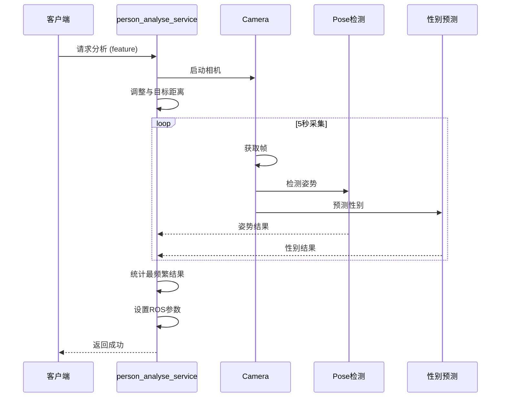

# seu_person_analyse 技术报告

> **版本**: 1.0  
> **日期**: 2025-12-25  
> **包路径**: `/home/duo/GPSR_ws_zyd/GPSR_code/src/seu_person_analyse`

---
## 现有问题：

1. 人在近处时无法区分point left/right 和raise left/right
2. 在一只手下垂一只手point时容易误识别另一只手，干扰point结果
3. 衣服颜色识别原有代码依靠百度api，建议改为本地识别

## 目录

1. [用法与命令](#1-用法与命令)
2. [功能详细描述](#2-功能详细描述)
3. [外部依赖](#3-外部依赖)
4. [超参数表](#4-超参数表)
5. [完整代码解释与Review](#5-完整代码解释与review)

---

## 1. 用法与命令

### 1.1 编译

```bash
# 单独编译该包
cd /home/duo/GPSR_ws_zyd/GPSR_code
catkin build seu_person_analyse
source devel/setup.bash
```

### 1.2 运行服务节点

```bash
# 启动 roscore（如未启动）
roscore

# 在新终端运行服务节点
rosrun seu_person_analyse person_analyse.py
```

### 1.3 调用服务

```bash
# 调用人员分析服务
rosservice call /person_analyse_service "feature: 'all'"
```

### 1.4 运行离线测试

```bash
# 无需 roscore，直接运行测试脚本
python3 /home/duo/GPSR_ws_zyd/GPSR_code/src/seu_person_analyse/test/test.py
```

---

## 2. 功能详细描述

### 2.1 整体架构



### 2.2 主要功能

| 功能模块 | 描述 | 实现类/函数 |
|---------|------|------------|
| **姿势识别** | 检测举手、挥手、指向、坐姿等姿势 | `Pose` 类 |
| **人体追踪** | 使用 YOLOv8 检测并追踪人体 | `PersonTrack` 类 |
| **性别预测** | 使用 DeepFace 预测性别 | `predict_gender()` 函数 |
| **人脸识别** | 检测、编码、记录人脸 | `People_analyse` 类 |
| **衣物颜色** | 通过百度API识别上衣颜色 | `Cloth` 类 |
| **物体检测** | 使用自定义YOLO模型检测物体 | `ObjDetect` 类 |
| **3D定位** | 计算目标的3D空间坐标 | `get_3d_camera_coordinate()` |
| **距离调整** | 控制机器人与目标保持适当距离 | `adjust_distance()` 方法 |

### 2.3 服务流程



---

## 3. 外部依赖

### 3.1 依赖的 ROS 话题

| 话题名称 | 消息类型 | 方向 | 描述 |
|---------|---------|------|------|
| `/robot_pose` | `geometry_msgs/PoseStamped` | 订阅 | 机器人当前位姿 |
| `/cmd_vel` | `geometry_msgs/Twist` | 发布 | 机器人速度控制命令 |
| `/gpsr_img` | `sensor_msgs/Image` | 发布 | 处理后的图像（调试用） |

### 3.2 依赖的 ROS 服务

| 服务名称 | 服务类型 | 描述 |
|---------|---------|------|
| `person_analyse_service` | `seu_person_analyse/seu_person_analyse` | 本包提供的主服务 |

### 3.3 依赖的外部代码

| 模块路径 | 导入内容 | 描述 |
|---------|---------|------|
| `common/camera.py` | `Camera`, `predict_gender` | 相机管理和核心功能实现 |
| TF2 变换 | `tf2_ros`, `tf2_geometry_msgs` | 坐标系变换（camera → map） |

### 3.4 依赖的模型文件

| 模型路径 | 用途 |
|---------|------|
| `common/models/yolov8n.pt` | 人体检测（YOLOv8n） |
| `common/models/epoch10.pt` | 物体检测（自定义训练） |
| `model/gesture_recognizer.task` | MediaPipe 手势识别（未使用） |

### 3.5 Python 包依赖

| 包名 | 版本要求 | 用途 |
|-----|---------|------|
| `opencv-python` | >= 4.5 | 图像处理 |
| `numpy` | >= 1.19 | 数值计算 |
| `mediapipe` | >= 0.10 | 姿势/手势检测 |
| `deepface` | >= 0.0.79 | 性别预测 |
| `ultralytics` | >= 8.0 | YOLOv8 模型 |
| `face_recognition` | >= 1.3 | 人脸检测与编码 |
| `pyrealsense2` | >= 2.50 | RealSense 相机驱动 |
| `requests` | >= 2.25 | HTTP 请求（百度API） |
| `scipy` | >= 1.7 | 向量距离计算 |

---

## 4. 超参数表

### 4.1 相机参数

| 参数名 | 位置 | 默认值 | 描述 |
|-------|------|--------|------|
| `image_width` | `Camera.__init__` | 640 | 图像宽度 |
| `image_height` | `Camera.__init__` | 480 | 图像高度 |
| `serial_number` | `Camera.__init__` | None | RealSense 相机索引 |

### 4.2 检测阈值

| 参数名 | 位置 | 默认值 | 描述 |
|-------|------|--------|------|
| `min_detection_confidence` | `Pose.__init__` | 0.5 | 姿势检测最小置信度 |
| `min_tracking_confidence` | `Pose.__init__` | 0.5 | 姿势追踪最小置信度 |
| `threshold` | `People_analyse.check_if_recorded` | 0.05 | 人脸匹配余弦距离阈值 |
| `wave_threshold` | `Pose._update_arm_status_from_pose` | 0.15 | 挥手检测阈值 |
| `conf` | `ObjDetect.get_obj` | 0.1 | 物体检测置信度阈值 |
| `iou` | `ObjDetect.get_obj` | 0.45 | NMS IOU 阈值 |

### 4.3 控制参数

| 参数名 | 位置 | 默认值 | 描述 |
|-------|------|--------|------|
| `yaw_error_threshold` | `adjust_distance` | 0.05 rad | 角度对齐容差 |
| `angular_speed` | `adjust_distance` | 0.3 rad/s | 旋转速度 |
| `linear_speed` | `adjust_distance` | -0.1 m/s | 后退速度（负值） |
| `target_distance` | `adjust_distance` | 1.5 m | 目标保持距离 |
| `detect_times` | `adjust_distance` | 5 | 检测确认次数 |

### 4.4 时间参数

| 参数名 | 位置 | 默认值 | 描述 |
|-------|------|--------|------|
| `analyse_duration` | `person_analyse_callback` | 5 s | 分析采集时长 |

---

## 5. 完整代码解释与Review

### 5.1 person_analyse.py - 主服务文件

#### 文件头部

```python
#! /home/syw/anaconda3/envs/GPSR/bin/python
# -*- coding: UTF-8 -*-
```
> **说明**: 指定 Python 解释器路径和文件编码。建议修改为通用路径 `#!/usr/bin/env python3`。

#### 导入模块块 (Lines 3-23)

```python
import sys
import time
import cv2
sys.path.append("/home/syw/code/robocup_nation/2024code/GPSR/src")
from common.camera import Camera, predict_gender
import rospy
import tf2_ros
import actionlib
from move_base_msgs.msg import MoveBaseAction, MoveBaseGoal
from actionlib_msgs.msg import *
from std_msgs.msg import String
from sensor_msgs.msg import LaserScan
from geometry_msgs.msg import PoseStamped, Point, PoseWithCovarianceStamped, Pose, Quaternion, Twist
from tf2_geometry_msgs import tf2_geometry_msgs
from tf.transformations import euler_from_quaternion, quaternion_from_euler
import math
from cv_bridge import CvBridge
import sensor_msgs.msg
from seu_robot_msgs.msg import object_position
from seu_person_analyse.srv import *
```

**代码Review**:
- ⚠️ 硬编码路径 `sys.path.append(...)` 不够灵活，建议使用相对路径或环境变量
- ⚠️ 导入了一些未使用的模块（如 `LaserScan`, `String`, `actionlib`）

---

#### Person_analyse_service 类 (Lines 27-204)

##### `__init__` 方法 (Lines 28-42)

```python
def __init__(self):
    self.start_pose = None
    self.camera = Camera(serial_number=1)
    rospy.Subscriber('/robot_pose', PoseStamped, self.pose_callback)
    self.current_pose = PoseStamped()
    self.target_point = Point()
    self.cmd_vel_pub = rospy.Publisher('/cmd_vel', Twist, queue_size=10)
    self.pose = {}
    self.gender = {}
    self.cloth_color = {}
    self.bridge = CvBridge()
    self.name = None
    self.image_pub = rospy.Publisher("/gpsr_img", sensor_msgs.msg.Image, queue_size=10)
```

**功能说明**:
- 初始化相机（使用第2个RealSense相机，`serial_number=1`）
- 订阅机器人位姿话题
- 创建速度控制和图像发布器
- 初始化统计字典

**代码Review**:
- ✅ 正确初始化ROS订阅者和发布者
- ⚠️ `self.pose` 和 `self.gender` 字典在每次调用前应清空

---

##### `person_analyse_callback` 方法 (Lines 43-102)

```python
def person_analyse_callback(self, req):
    feature = req.feature
    rospy.loginfo(f"start person analyse:{feature}")
    self.camera.start_camera()
    
    response = seu_person_analyseResponse()
    self.start_pose = rospy.wait_for_message('/robot_pose', PoseStamped)
    self.adjust_distance()
    start_time = time.time()
    
    while time.time() - start_time < 5:
        color_image, depth_image, depth_intrin, depth_frame = self.camera.get_frame()
        if color_image is not None:
            color_image = cv2.cvtColor(color_image, cv2.COLOR_BGR2RGB)
            pose = self.camera.pose.get_pose(color_image)
            if pose != 'none':
                if pose in self.pose.keys():
                    self.pose[pose] += 1
                else:
                    self.pose[pose] = 1
            gender = predict_gender(color_image)
            if gender in self.gender.keys():
                self.gender[gender] += 1
            else:
                self.gender[gender] = 1
            # ... 发布图像 ...
    
    # 统计最频繁的结果
    if self.pose:
        most_frequent_pose = max(self.pose.items(), key=lambda x: x[1])
        pose = most_frequent_pose[0]
    else:
        pose = "uncertain"
    
    if self.gender:
        most_frequent_gender = max(self.gender.items(), key=lambda x: x[1])
        gender = most_frequent_gender[0]
    else:
        gender = "uncertain"
    
    rospy.set_param("gesture", pose)
    rospy.set_param("gender", gender)
    rospy.set_param("person_info", f"with pose {pose} and gender is {gender}")
    response.state = True
    return response
```

**功能说明**:
1. 启动相机
2. 调用 `adjust_distance()` 调整与目标的距离
3. 在5秒内持续采集图像
4. 对每帧进行姿势检测和性别预测
5. 统计出现频率最高的结果
6. 将结果写入ROS参数服务器

**代码Review**:
- ✅ 使用投票机制（统计最频繁结果）提高准确性
- ✅ 设置ROS参数便于其他节点读取
- ⚠️ `self.pose` 和 `self.gender` 未在方法开始时清空，可能累积上次调用的结果
- ⚠️ 5秒硬编码，建议作为参数

---

##### `adjust_distance` 方法 (Lines 104-200)

```python
def adjust_distance(self):
    self.start_pose = rospy.wait_for_message('/robot_pose', PoseStamped)
    detect_times = 0
    
    # 阶段1: 找最近的人
    while True:
        color_image, depth_image, depth_intrin, depth_frame = self.camera.get_frame()
        if color_image is not None:
            results = self.camera.people_track.detect_people(
                color_image, depth_frame=depth_frame, depth_intrin=depth_intrin)
            nearest = None
            min_distance = 100
            for res in results:
                x1, y1, x2, y2, pos = res
                if pos is not None:
                    if pos[1][2] < min_distance:
                        min_distance = pos[1][2]
                        nearest = pos[1]
            detect_times += 1
            if nearest is not None and detect_times >= 5:
                break
            # ... 发布图像 ...
    
    # 坐标变换: 相机坐标系 -> 地图坐标系
    ps = tf2_geometry_msgs.PointStamped()
    ps.header.frame_id = "camera1_color_optical_frame"
    ps.point.x, ps.point.y, ps.point.z = nearest[0], nearest[1], nearest[2]
    ps_out = buffer.transform(ps, "map")
    self.target_point.x = ps_out.point.x
    self.target_point.y = ps_out.point.y
    
    # 阶段2: 对齐角度
    while not rospy.is_shutdown():
        target_yaw = math.atan2(
            self.target_point.y - self.start_pose.pose.position.y,
            self.target_point.x - self.start_pose.pose.position.x)
        current_yaw = euler_from_quaternion([
            self.current_pose.pose.orientation.x,
            self.current_pose.pose.orientation.y,
            self.current_pose.pose.orientation.z,
            self.current_pose.pose.orientation.w])[2]
        yaw_error = target_yaw - current_yaw
        # 角度归一化
        if yaw_error > math.pi:
            yaw_error -= 2 * math.pi
        elif yaw_error < -math.pi:
            yaw_error += 2 * math.pi
        
        if abs(yaw_error) < 0.05:  # 角度对齐完成
            self.cmd_vel_pub.publish(Twist())
            break
        
        cmd_vel = Twist()
        cmd_vel.angular.z = 0.3 * yaw_error / abs(yaw_error)
        self.cmd_vel_pub.publish(cmd_vel)
        rospy.sleep(0.1)
    
    # 阶段3: 调整距离
    while not rospy.is_shutdown():
        distance = math.sqrt(
            pow(self.target_point.x - self.current_pose.pose.position.x, 2) +
            pow(self.target_point.y - self.current_pose.pose.position.y, 2))
        if distance > 1.5:
            self.cmd_vel_pub.publish(Twist())
            break
        cmd_vel = Twist()
        cmd_vel.linear.x = -0.1  # 后退
        self.cmd_vel_pub.publish(cmd_vel)
        rospy.sleep(0.1)
    
    return True
```

**功能说明**:
1. **人员检测**: 连续检测5次确认最近的人
2. **坐标变换**: 将相机坐标系中的位置转换到地图坐标系
3. **角度对齐**: 旋转机器人朝向目标人员
4. **距离调整**: 后退直到与目标距离超过1.5米

**代码Review**:
- ✅ 使用连续检测确认机制减少误检
- ✅ 正确处理角度环绕问题
- ⚠️ 使用全局变量 `buffer`，应该作为类成员
- ⚠️ 硬编码的参数（0.05, 0.3, 1.5, 0.1）应该提取为常量

---

##### `pose_callback` 方法 (Lines 202-204)

```python
def pose_callback(self, msg):
    self.current_pose = msg
```

**功能说明**: 回调函数，更新当前机器人位姿。

---

#### 主入口 (Lines 206-218)

```python
if __name__ == "__main__":
    rospy.init_node('person_analyse_service_node')
    buffer = tf2_ros.Buffer()
    sub = tf2_ros.TransformListener(buffer)
    person_analyse_service = Person_analyse_service()
    server = rospy.Service("person_analyse_service", seu_person_analyse, 
                           person_analyse_service.person_analyse_callback)
    rospy.loginfo("person analyse service ready")
    rospy.spin()
```

**功能说明**:
- 初始化ROS节点
- 创建TF2缓冲区和监听器
- 注册服务并进入ROS循环

**代码Review**:
- ⚠️ `buffer` 和 `sub` 是全局变量，应该传入类中
- ✅ 正确使用 `rospy.spin()` 保持节点运行

---

### 5.2 common/camera.py - 核心功能实现

#### predict_gender 函数 (Lines 75-82)

```python
def predict_gender(face_img_rgb):
    try:
        analysis = DeepFace.analyze(img_path=face_img_rgb, actions=["gender"], 
                                    enforce_detection=False)
        gender = analysis[0]['dominant_gender'] if isinstance(analysis, list) else analysis['dominant_gender']
        return "woman" if gender.lower() == "woman" else "man"
    except Exception as e:
        print(f"⚠️ 性别识别失败: {e}")
        return "unknown"
```

**功能说明**: 使用 DeepFace 分析图像中的性别。

**参数**:
- `face_img_rgb`: RGB 格式的图像

**返回值**:
- `"man"`, `"woman"`, 或 `"unknown"`

**代码Review**:
- ✅ 设置 `enforce_detection=False` 避免在检测不到人脸时崩溃
- ✅ 统一返回值格式（小写）

---

#### get_3d_camera_coordinate 函数 (Lines 85-93)

```python
def get_3d_camera_coordinate(x, y, aligned_depth_frame, depth_intrin):
    """计算3D相机坐标"""
    pix_x = int(x)
    pix_y = int(y)
    dis = aligned_depth_frame.get_distance(pix_x, pix_y)
    camera_coordinate = rs.rs2_deproject_pixel_to_point(
        depth_intrin, [pix_x, pix_y], dis
    )
    return dis, camera_coordinate
```

**功能说明**: 将2D像素坐标转换为3D相机坐标。

**参数**:
- `x, y`: 像素坐标
- `aligned_depth_frame`: 对齐后的深度帧
- `depth_intrin`: 深度相机内参

**返回值**:
- `dis`: 深度值（米）
- `camera_coordinate`: 3D坐标 [x, y, z]

---

#### Pose 类 (Lines 259-416)

##### `__init__` 方法

```python
def __init__(self, image_width=640, image_height=480):
    self.image_width = image_width
    self.image_height = image_height
    self.mp_pose = mp.solutions.pose
    self.mp_hands = mp.solutions.hands.Hands(
        static_image_mode=True,
        max_num_hands=2,
        min_detection_confidence=0.5
    )
    self.pose = self.mp_pose.Pose(
        min_detection_confidence=0.5,
        min_tracking_confidence=0.5
    )
    self.left_h_distance_pre = 0
    self.right_h_distance_pre = 0
    self.raise_arm = "None"
    self.wave_hand = "None"
```

**功能说明**: 初始化 MediaPipe 的姿势和手部检测模型。

---

##### `detect_gesture` 方法 (Lines 279-317)

```python
def detect_gesture(self, color_image, draw=False, width=640, height=480):
    """检测手势并区分左右手"""
    img = cv2.cvtColor(color_image, cv2.COLOR_BGR2RGB)
    hands_results = self.mp_hands.process(img)
    point_pos = None
    
    if hands_results.multi_hand_landmarks and hands_results.multi_handedness:
        for hand_landmarks, hand_handedness in zip(
            hands_results.multi_hand_landmarks, 
            hands_results.multi_handedness):
            
            hand_label = hand_handedness.classification[0].label
            # 镜像翻转左右手标签
            hand_label = 'Right' if hand_label == 'Left' else 'Left'
            
            index_finger_mcp = hand_landmarks.landmark[5]
            index_finger_tip = hand_landmarks.landmark[8]
            
            # 判断食指是否水平伸出
            if 0 < index_finger_tip.x < 1:
                if abs(index_finger_mcp.y - index_finger_tip.y) < 0.1:
                    if index_finger_mcp.x > index_finger_tip.x:
                        point_pos = 'right'
                    else:
                        point_pos = 'left'
    
    return point_pos
```

**功能说明**: 检测手指指向方向。

**算法**:
1. 使用 MediaPipe Hands 检测手部关键点
2. 获取食指根部(MCP)和指尖(TIP)的坐标
3. 如果食指水平伸出（Y坐标差异小于0.1），判断指向方向

---

##### `detect_sitting_pose` 方法 (Lines 319-344)

```python
def detect_sitting_pose(self, color_image, draw=False, width=640, height=480):
    """检测坐姿并更新手势状态"""
    img = cv2.cvtColor(color_image, cv2.COLOR_BGR2RGB)
    pose_results = self.pose.process(img)
    raise_arm = None
    wave_hand = None
    is_sitting = False
    
    if pose_results.pose_landmarks:
        landmarks = pose_results.pose_landmarks.landmark
        raise_arm, wave_hand = self._update_arm_status_from_pose(landmarks)
        
        # 坐姿检测: 膝盖和髋部的Y坐标接近
        is_sitting = (
            abs(landmarks[self.mp_pose.PoseLandmark.LEFT_KNEE].y -
                landmarks[self.mp_pose.PoseLandmark.LEFT_HIP].y) < 0.3 and
            abs(landmarks[self.mp_pose.PoseLandmark.RIGHT_KNEE].y -
                landmarks[self.mp_pose.PoseLandmark.RIGHT_HIP].y) < 0.3
        )
    
    return is_sitting, raise_arm, wave_hand
```

**功能说明**: 检测坐姿和手臂状态。

**坐姿检测算法**: 如果左右膝盖与髋部的垂直距离都小于0.3（归一化坐标），则判定为坐姿。

---

##### `_update_arm_status_from_pose` 方法 (Lines 346-381)

```python
def _update_arm_status_from_pose(self, landmarks):
    """使用姿势关键点更新举手/挥手状态"""
    left_shoulder = landmarks[self.mp_pose.PoseLandmark.LEFT_SHOULDER]
    right_shoulder = landmarks[self.mp_pose.PoseLandmark.RIGHT_SHOULDER]
    left_wrist = landmarks[self.mp_pose.PoseLandmark.LEFT_WRIST]
    right_wrist = landmarks[self.mp_pose.PoseLandmark.RIGHT_WRIST]
    
    left_v = left_wrist.y - left_shoulder.y   # 垂直距离
    right_v = right_wrist.y - right_shoulder.y
    left_h = left_wrist.x - left_shoulder.x   # 水平距离
    right_h = right_wrist.x - right_shoulder.x
    
    raise_arm = None
    # 举手判断: 手腕在肩膀上方
    if left_v < -0.05 and right_v < -0.05:
        raise_arm = "left" if left_v < right_v else "right"
    elif left_v < -0.05:
        raise_arm = "left"
    elif right_v < -0.05:
        raise_arm = "right"
    
    # 挥手判断: 水平位置变化
    wave_threshold = 0.15
    if abs(left_h - self.left_h_distance_pre) > wave_threshold or \
       abs(right_h - self.right_h_distance_pre) > wave_threshold:
        wave_hand = "waving"
    else:
        wave_hand = None
    
    self.left_h_distance_pre = left_h
    self.right_h_distance_pre = right_h
    return raise_arm, wave_hand
```

**功能说明**: 检测举手和挥手状态。

**举手检测**: 手腕Y坐标低于肩膀Y坐标超过0.05（注意：图像坐标系Y轴向下）

**挥手检测**: 手腕水平位置相对上一帧的变化超过0.15

---

##### `get_pose` 方法 (Lines 389-416)

```python
def get_pose(self, color_image, feature=None, width=640, height=480):
    point_pos = self.detect_gesture(color_image, True, width=width, height=height)
    is_sitting, raise_arm, wave_hand = self.detect_sitting_pose(
        color_image, True, width=width, height=height)
    
    if feature is None:
        if point_pos is not None:
            return f"pointing {point_pos}"
        elif wave_hand is not None:
            return f"waving"
        elif raise_arm is not None:
            return f"raising {raise_arm} arm"
        else:
            return f"none"
    elif feature == "pointing":
        if point_pos is not None:
            return f"pointing {point_pos}"
    elif feature == "raising":
        if wave_hand is not None:
            return f"waving"
        elif raise_arm is not None:
            return f"raising {raise_arm} arm"
    elif feature == "sitting":
        return f"sitting" if is_sitting else f"standing"
    
    return "none"
```

**功能说明**: 综合检测所有姿势，返回最显著的姿势描述。

**优先级**: 指向 > 挥手 > 举手

---

#### PersonTrack 类 (Lines 128-170)

```python
class PersonTrack:
    def __init__(self, model_path='.../yolov8n.pt'):
        self.detector = YOLO(model_path, verbose=False)
        self.pose = mp.solutions.pose.Pose(static_image_mode=True)
        self.mp_pose = mp.solutions.pose
    
    def detect_people(self, image, depth_frame=None, depth_intrin=None):
        """使用YOLOv8检测所有人"""
        results = self.detector(image, verbose=False)
        boxes = []
        for r in results:
            for box, cls in zip(r.boxes.xyxy, r.boxes.cls):
                if int(cls) == 0:  # class 0 == 'person'
                    x1, y1, x2, y2 = map(int, box)
                    pos = None
                    if depth_frame is not None:
                        # 通过肩膀位置计算3D坐标
                        left, right = self.extract_pose_from_box(image, (x1, y1, x2, y2))
                        if left[0] is not None:
                            center = ((left[0] + right[0]) // 2, (left[1] + right[1]) // 2)
                            pos = get_3d_camera_coordinate(
                                center[0], center[1], depth_frame, depth_intrin)
                    boxes.append((x1, y1, x2, y2, pos))
        return boxes
```

**功能说明**: 使用 YOLOv8 检测人体，并可选地计算3D位置。

**3D位置计算**: 通过 MediaPipe Pose 获取肩膀中心点，然后使用深度信息计算3D坐标。

---

#### People_analyse 类 (Lines 173-256)

##### 主要方法

```python
class People_analyse:
    def __init__(self, known_path="known_faces"):
        self.known_path = known_path
        self.known_faces = {}   # 已知人脸: id -> embedding
        self.record_faces = {}  # 新记录人脸: id -> embedding
        os.makedirs(self.known_path, exist_ok=True)
        self._load_database(self.known_path, self.known_faces)
    
    def get_embedding_from_path(self, img_path):
        """获取人脸128维特征向量"""
        image = face_recognition.load_image_file(img_path)
        encodings = face_recognition.face_encodings(image)
        return encodings[0].tolist() if encodings else None
    
    def analyze_faces(self, color_image):
        """检测人脸并分析性别"""
        img_rgb = cv2.cvtColor(color_image, cv2.COLOR_BGR2RGB)
        face_locations = face_recognition.face_locations(img_rgb, model='vog')
        face_encodings = face_recognition.face_encodings(img_rgb, face_locations)
        
        results = []
        for (top, right, bottom, left), encoding in zip(face_locations, face_encodings):
            face_img = img_rgb[top:bottom, left:right]
            gender = predict_gender(face_img)
            results.append({
                "face_position": (left, top, right - left, bottom - top),
                "gender": gender,
                "embedding": encoding.tolist()
            })
        return results
    
    def check_if_recorded(self, face_embedding, threshold=0.05):
        """检查人脸是否已记录（余弦距离比较）"""
        for face_id, known_embedding in self.known_faces.items():
            if cosine(face_embedding, known_embedding) < threshold:
                return face_id
        for face_id, new_embedding in self.record_faces.items():
            if cosine(face_embedding, new_embedding) < threshold:
                return face_id
        return None
    
    def record_face(self, face_embedding):
        """记录新人脸，返回ID"""
        existing_id = self.check_if_recorded(face_embedding)
        if existing_id:
            return existing_id
        new_id = f"person_{len(self.record_faces) + 1:03d}"
        self.record_faces[new_id] = face_embedding
        return new_id
```

**功能说明**:
- 使用 `face_recognition` 库检测人脸并提取128维特征向量
- 使用余弦距离比较人脸相似度
- 支持从已知人脸库中识别，也可以记录新人脸

**阈值说明**: 默认余弦距离阈值0.05非常严格，可能需要根据实际情况调整。

---

#### Cloth 类 (Lines 419-502)

```python
class Cloth:
    def __init__(self):
        self.API_KEY = "qdHHrNUVxPT5epB9tkMyg3ma"
        self.SECRET_KEY = "ALmrJxY0iEotVYzDo8IcWX3iFGrvQxjZ"
    
    def bodyanalysis(self, img_input):
        """使用百度API分析上衣颜色"""
        access_token = self.get_access_token()
        # ... 图像转base64 ...
        
        url = f"https://aip.baidubce.com/rest/2.0/image-classify/v1/body_attr?access_token={access_token}"
        params = {"image": image_base64, "type": "upper_color"}
        response = requests.post(url, data=params, headers=headers)
        
        # 解析返回的颜色名称（中文）并转换为英文
        if "person_info" in result:
            for person in result["person_info"]:
                upper_attr = person["attributes"].get("upper_color", {})
                name = upper_attr.get("name", "")
                if name not in ["不确定", "未知"]:
                    return color_cn2en[name]
        return None
```

**功能说明**: 调用百度人体分析API识别上衣颜色。

**注意**: API密钥硬编码在代码中，建议使用环境变量或配置文件。

---

#### Camera 类 (Lines 505-686)

##### `__init__` 方法

```python
def __init__(self, camera_type='realsense', serial_number=None):
    self.camera_type = camera_type
    self.serial_number = serial_number
    self.image_width = 640
    self.image_height = 480
    
    # 初始化所有分析组件
    self.people_track = PersonTrack()
    self.pose = Pose(image_width=self.image_width, image_height=self.image_height)
    self.people_analyse = People_analyse()
    self.cloth = Cloth()
    
    if self.camera_type == 'realsense':
        self.align = rs.align(rs.stream.color)
        self.config = rs.config()
        self.config.enable_stream(rs.stream.depth, 640, 480, rs.format.z16, 30)
        self.config.enable_stream(rs.stream.color, 640, 480, rs.format.bgr8, 30)
        self.pipeline = rs.pipeline()
```

**功能说明**: 相机管理类，集成所有分析组件，支持 RealSense 和普通 Webcam。

---

##### `get_frame` 方法

```python
def get_frame(self):
    """获取当前帧"""
    if not self.camera_state:
        return None, None, None, None
    
    if self.camera_type == 'realsense':
        frames = self.pipeline.wait_for_frames()
        aligned_frames = self.align.process(frames)
        color_frame = aligned_frames.get_color_frame()
        depth_frame = aligned_frames.get_depth_frame()
        
        color_image = np.asanyarray(color_frame.get_data())
        depth_image = np.asanyarray(depth_frame.get_data())
        depth_intrin = depth_frame.profile.as_video_stream_profile().intrinsics
        return color_image, depth_image, depth_intrin, depth_frame
    
    elif self.camera_type == 'webcam':
        ret, frame = self.cap.read()
        return frame, None, None, None
```

**功能说明**: 获取相机帧，对于 RealSense 会返回对齐后的深度信息。

---

### 5.3 服务定义文件

#### seu_person_analyse.srv

```
string feature
---
bool state
string errormsg
```

**请求字段**:
- `feature`: 分析特征（目前未使用，可传 "all"）

**响应字段**:
- `state`: 分析是否成功
- `errormsg`: 错误信息（如果失败）

---

## 总结

### 代码质量评估

| 方面 | 评分 | 说明 |
|------|------|------|
| **功能完整性** | ★★★★☆ | 覆盖主要人员分析功能 |
| **代码可读性** | ★★★☆☆ | 有注释但不够详细 |
| **可维护性** | ★★☆☆☆ | 硬编码较多，模块耦合 |
| **错误处理** | ★★★☆☆ | 基本的异常捕获 |
| **测试覆盖** | ★★★★☆ | 测试脚本完整 |

### 改进建议

1. **配置外部化**: 将硬编码的路径、阈值、API密钥移到配置文件
2. **代码解耦**: 将 `buffer` 等全局变量移入类中
3. **日志增强**: 使用结构化日志替代 print
4. **类型注解**: 添加 Python 类型提示
5. **单元测试**: 补充更多边界条件测试

---

*报告生成时间: 2025-12-25*
