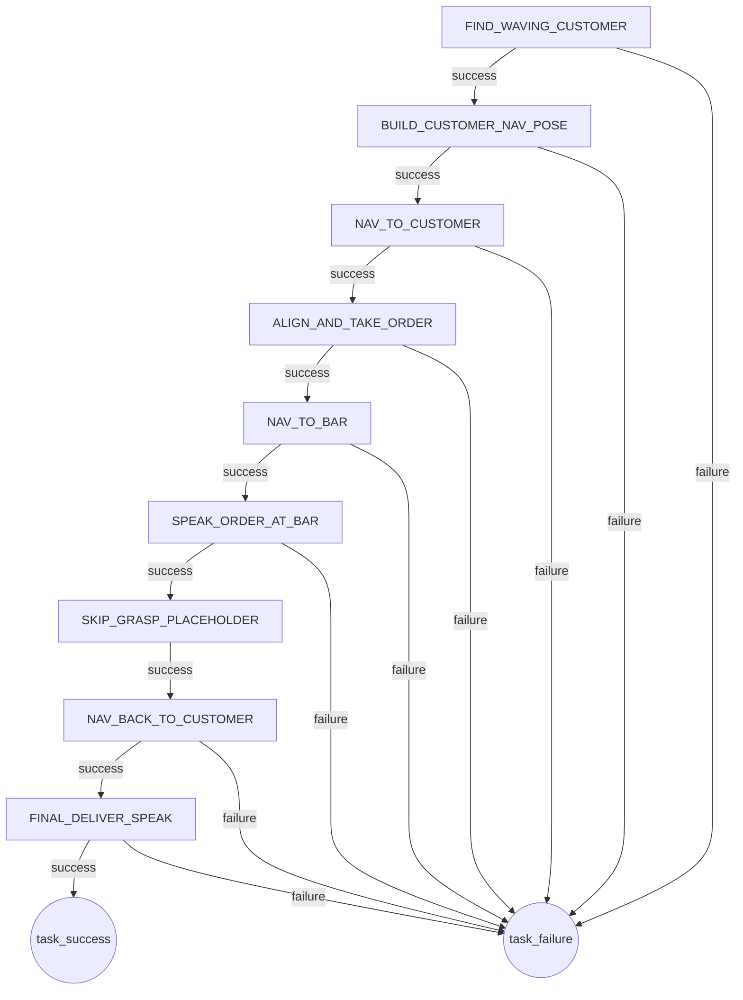

# *SEU RoboCup@Home Restaurant 2026*

东南大学自动化学院 RoboCup@Home Restaurant 赛题代码

<!-- 

  周艺舵 
  东南大学自动化学院 (School of Automation, Southeast University)

**Environment**

- Ubuntu 20.04
- ROS Noetic
- Python 3.10 -->

- 代码作者：东南大学自动化学院机器人工程系 周艺舵
- 开发基础环境：Ubuntu 20.04 + ROS Noetic

## 1. 状态机流程图
根据代码逻辑，状态机的流转如下：

---
*SEU RoboCup Team 2026*