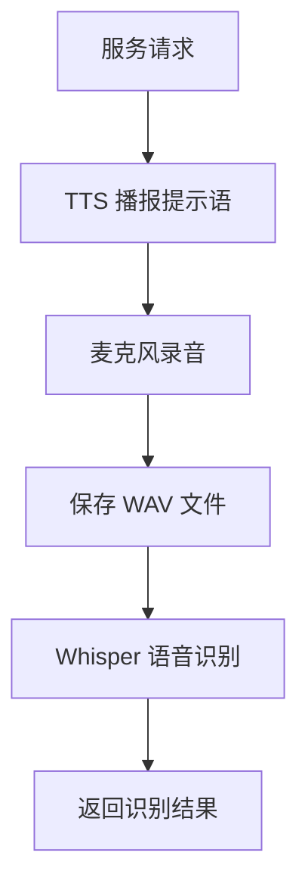

# seu_speech_recognition 技术报告

## 1. 功能详细描述

该 ROS 功能包提供基于 **OpenAI Whisper** 的本地语音识别服务，主要功能包括：

### 1.1 核心功能

| 功能 | 描述 | 实现位置 |
|------|------|----------|
| **语音录制** | 通过麦克风采集音频，保存为 WAV 格式 | `my_whisper.py:record_audio()` |
| **音频降噪** | Butterworth 低通滤波器降噪 | `my_whisper.py:denoise_audio()` |
| **语音识别** | Whisper 模型将语音转为文本 | `my_whisper.py:transcribe_audio()` |
| **TTS 语音合成** | pyttsx3 播报识别结果 | `my_whisper.py:speech_to_text()` |
| **ROS 服务** | 提供语音识别服务接口 | `speech_service.py` |

### 1.2 工作流程



### 1.3 服务定义

**服务类型**: `seu_speech_recognition/seu_speech_recognition`

**请求 (Request)**:
```
bool enable     # 启用标志（预留）
string task     # 任务类型: "command" | "answer" | 其他
```

**响应 (Response)**:
```
bool state      # 识别状态: true=成功, false=失败
int64 errorcode # 错误码: 0=成功, 1=空结果, -1=异常
string word     # 识别的文本内容
string errormsg # 错误信息: "success" | "empty" | "failure"
```

---

## 2. 外部依赖

### 2.1 依赖的 ROS 话题

| 话题名称 | 类型 | 用途 |
|----------|------|------|
| 无 | - | 本服务不订阅任何话题 |

### 2.2 依赖的 ROS 服务

| 服务名称 | 类型 | 用途 |
|----------|------|------|
| 无 | - | 本服务不调用其他服务 |

### 2.3 提供的 ROS 服务

| 服务名称 | 类型 | 用途 |
|----------|------|------|
| `/speech_recognition_service` | `seu_speech_recognition` | 语音识别服务 |

### 2.4 依赖的 ROS 参数

| 参数名称 | 类型 | 用途 |
|----------|------|------|
| `log` | string | 日志文件路径 |

### 2.5 依赖的外部 Python 库

| 库名称 | 版本 | 用途 |
|--------|------|------|
| `openai-whisper` | >= 20231117 | 语音识别模型 |
| `torch` | >= 2.0 | PyTorch 深度学习框架 |
| `pyaudio` | >= 0.2.11 | 音频录制 |
| `pyttsx3` | >= 2.90 | TTS 语音合成 |
| `scipy` | >= 1.10 | 音频处理/降噪 |
| `numpy` | >= 1.24 | 数值计算 |
| `wave` | 标准库 | WAV 文件处理 |

### 2.6 依赖的模型文件

| 文件名 | 大小 | 说明 |
|--------|------|------|
| `base.pt` | ~140 MB | Whisper base 模型 |
| `small.en.pt` | ~460 MB | Whisper small 英文模型 |
| `large-v3-turbo.pt` | ~1.5 GB | Whisper large-v3-turbo 模型（当前使用） |

---

## 3. 可调超参数表

### 3.1 录音参数

| 参数 | 默认值 | 位置 | 说明 |
|------|--------|------|------|
| `max_duration` | 10 | `my_whisper.py:record_audio()` | 最大录音时长（秒） |
| `silence_timeout` | 3 | `my_whisper.py:record_audio()` | 静音超时（秒，未使用） |
| `sample_rate` | 16000 | `my_whisper.py:record_audio()` | 采样率（Hz） |
| `channels` | 1 | `my_whisper.py:record_audio()` | 音频通道数 |
| `frames_per_buffer` | 1024 | `my_whisper.py:record_audio()` | 缓冲区大小 |

### 3.2 降噪参数

| 参数 | 默认值 | 位置 | 说明 |
|------|--------|------|------|
| `cutoff` | 5000.0 | `my_whisper.py:denoise_audio()` | 低通滤波截止频率（Hz） |
| `order` | 5 | `my_whisper.py:denoise_audio()` | Butterworth 滤波器阶数 |

### 3.3 Whisper 模型参数

| 参数 | 默认值 | 位置 | 说明 |
|------|--------|------|------|
| `model_name` | `large-v3-turbo.pt` | `my_whisper.py` 底部 | 模型文件路径 |
| `language` | `"en"` | `my_whisper.py` 底部 | 识别语言 |
| `device` | `"cpu"` | `SimpleSpeechRecognizer.__init__()` | 运行设备 |

### 3.4 TTS 语音合成参数

| 参数 | 默认值 | 位置 | 说明 |
|------|--------|------|------|
| `voice` | `voices[10].id` | `my_whisper.py:speech_to_text()` | 语音音色 |
| `rate` | 160 | `my_whisper.py:speech_to_text()` | 语速 |

---

## 4. 代码详细解释

### 4.1 my_whisper.py - 核心 Whisper 识别模块

```python
#! /home/syw/anaconda3/envs/GPSR/bin/python
```
> Shebang 行，指定使用 conda 环境中的 Python 解释器。

---

```python
import os
import rospy
import pyttsx3
import torch
import whisper
import pyaudio
import wave
from typing import Optional
from scipy.io import wavfile
import numpy as np
from seu_speech_recognition.srv import *
from datetime import datetime
```
> 导入模块：
> - `os`: 文件路径操作
> - `rospy`: ROS Python 客户端库
> - `pyttsx3`: 文本转语音引擎
> - `torch`: PyTorch 框架（Whisper 依赖）
> - `whisper`: OpenAI Whisper 语音识别库
> - `pyaudio`: 音频录制
> - `wave`: WAV 文件读写
> - `scipy.io.wavfile`: 科学计算库的音频读写
> - `seu_speech_recognition.srv`: 自定义 ROS 服务消息

---

```python
AUDIO_OUTPUT_PATH = "/home/syw/code/robocup_nation/2024code/GPSR/src/seu_speech_recognition/scripts/wav/recording.wav"
PROCESSED_AUDIO_PATH = "denoised_audio.wav"
wav_path = '/home/syw/code/robocup_nation/2024code/GPSR/src/seu_speech_recognition/scripts/wav/recording.wav'
```
> **常量定义**：
> - `AUDIO_OUTPUT_PATH`: 录音文件保存路径
> - `PROCESSED_AUDIO_PATH`: 降噪后音频保存路径
> - `wav_path`: 待识别音频路径

---

```python
def get_info(key):
    try:
        result = rospy.get_param(key)
    except:
        result = None
    return result
```
> **函数**: `get_info(key)`
> - **功能**: 安全获取 ROS 参数
> - **参数**: `key` - ROS 参数名
> - **返回**: 参数值，获取失败返回 `None`

---

```python
def speech_to_text(data):
    speech=pyttsx3.init()
    voices=speech.getProperty('voices')
    speech.setProperty('voice',voices[10].id)
    speech.setProperty('rate',160)
    speech.say(data)
    speech.runAndWait()
    # ... 日志记录 ...
```
> **函数**: `speech_to_text(data)`
> - **功能**: TTS 语音播报
> - **参数**: `data` - 要播报的文本
> - **流程**:
>   1. 初始化 pyttsx3 引擎
>   2. 设置音色（第10个语音）
>   3. 设置语速为 160
>   4. 播报文本
>   5. 记录到日志文件

---

```python
class SimpleSpeechRecognizer:
    """简化语音处理类：提供录音、降噪、识别三步功能"""

    def __init__(self,
                 model_name: str = "base",
                 language: str = "en"):
        self.device = "cpu"
        self.language = language
        self.model_name = model_name
        print(f"加载 Whisper 模型: {model_name}")
        self.model = whisper.load_model(model_name, device=self.device)
```
> **类**: `SimpleSpeechRecognizer`
> - **构造函数参数**:
>   - `model_name`: Whisper 模型名称或路径
>   - `language`: 识别语言代码
> - **初始化逻辑**:
>   - 设置设备为 CPU
>   - 加载 Whisper 模型到内存

---

```python
def record_audio(self,
                 output_audio_path: str = AUDIO_OUTPUT_PATH,
                 max_duration: int = 10,
                 silence_timeout: int = 3) -> str:
    p = pyaudio.PyAudio()
    stream = p.open(format=pyaudio.paInt16,
                    channels=1,
                    rate=16000,
                    input=True,
                    frames_per_buffer=1024)
    frames = []
    try:
        for _ in range(0, int(16000 / 1024 * max_duration)):
            data = stream.read(1024)
            frames.append(data)
    except KeyboardInterrupt:
        print("录音结束。")
    # ... 保存 WAV ...
    return output_audio_path
```
> **方法**: `record_audio()`
> - **功能**: 从麦克风录制音频
> - **参数**:
>   - `output_audio_path`: 输出文件路径
>   - `max_duration`: 最大录音时长
>   - `silence_timeout`: 静音超时（未实现）
> - **流程**:
>   1. 初始化 PyAudio
>   2. 打开音频流（16kHz, 16-bit, 单声道）
>   3. 循环读取音频数据
>   4. 保存为 WAV 文件

---

```python
def denoise_audio(self,
                  input_path: str = AUDIO_OUTPUT_PATH,
                  output_path: str = PROCESSED_AUDIO_PATH) -> str:
    sample_rate, audio_data = wavfile.read(input_path)
    
    def butter_lowpass(cutoff, fs, order=5):
        nyquist = 0.5 * fs
        normal_cutoff = cutoff / nyquist
        b, a = butter(order, normal_cutoff, btype='low', analog=False)
        return b, a

    def butter_lowpass_filter(data, cutoff, fs, order=5):
        b, a = butter_lowpass(cutoff, fs, order)
        y = filtfilt(b, a, data)
        return y

    cutoff = 5000.0
    filtered_audio = butter_lowpass_filter(audio_data, cutoff, sample_rate)
    wavfile.write(output_path, sample_rate, filtered_audio.astype(np.int16))
    return output_path
```
> **方法**: `denoise_audio()`
> - **功能**: 使用 Butterworth 低通滤波器降噪
> - **原理**:
>   - Nyquist 频率 = 采样率 / 2
>   - 截止频率 5000 Hz 滤除高频噪声
>   - `filtfilt` 零相位滤波，避免相位失真

---

```python
def transcribe_audio(self,
                     audio_path: str,
                     language: Optional[str] = None) -> str:
    try:
        result = self.model.transcribe(audio_path, language=language or self.language)
        text = result.get("text", "").strip()
        return text
    except Exception as e:
        print(f"识别失败: {e}")
        return ""
```
> **方法**: `transcribe_audio()`
> - **功能**: 将音频文件转录为文本
> - **参数**:
>   - `audio_path`: 音频文件路径
>   - `language`: 语言代码（可选）
> - **返回**: 识别的文本字符串

---

```python
def recognition(self, req=None, path=wav_path):
    if req is not None:
        if req.task == "command":
            speech_to_text("please say the command")
        elif req.task == "answer":
            speech_to_text("please ask the question")
    try:
        recorded_path = self.record_audio()
        word = self.transcribe_audio(recorded_path)
        word = word.lower()
        if len(word) == 0:
            state, errorcode, errormsg = False, 1, 'empty'
        else:
            state, errorcode, errormsg = True, 0, 'success'
    except AttributeError:
        word, state, errorcode, errormsg = '', False, -1, 'failure'
    return seu_speech_recognitionResponse(state, errorcode, word, errormsg)
```
> **方法**: `recognition()`
> - **功能**: ROS 服务回调函数
> - **流程**:
>   1. 根据任务类型播报提示语
>   2. 录制音频
>   3. Whisper 识别
>   4. 返回服务响应

---

```python
recognizer = SimpleSpeechRecognizer(
    model_name="/home/syw/.../large-v3-turbo.pt",
    language="en")
```
> **全局实例**: 创建识别器实例，加载 large-v3-turbo 模型

---

### 4.2 speech_recogition.py - 独立测试脚本

该文件是 `SimpleSpeechRecognizer` 类的独立版本，不包含 ROS 依赖，可用于纯 Python 环境测试。

主要包含：
- `SimpleSpeechRecognizer` 类（与 my_whisper.py 相同）
- `__main__` 测试入口

---

### 4.3 speech_service.py - ROS 服务节点

```python
import os
import rospy 
from seu_speech_recognition.srv import *
from std_msgs.msg import String
import pyttsx3
from my_whisper import recognizer
from datetime import datetime
```
> 导入 ROS 相关模块和 `my_whisper.recognizer` 全局实例

---

```python
def main():
    rospy.init_node('speech_recognition_node')
    s = rospy.Service('speech_recognition_service', seu_speech_recognition, recognizer.recognition)
    rospy.loginfo("Ready to recognize speech (Whisper)")
    rospy.spin()
```
> **函数**: `main()`
> - 初始化 ROS 节点 `speech_recognition_node`
> - 注册服务 `/speech_recognition_service`
> - 服务回调使用 `recognizer.recognition` 方法
> - 进入 ROS 循环等待服务请求

---

### 4.4 speech_test.py - ROS 服务客户端测试

```python
def srv_speech_recognition():
    srv_name = seuhome_speech_recognition_name
    client = rospy.ServiceProxy(srv_name, seu_speech_recognition)
    rospy.wait_for_service(srv_name, timeout=1.0)
    # ... 调用服务 ...
```
> **功能**: 测试语音识别服务
> - 创建服务客户端
> - 调用服务并返回识别结果

---

## 5. 文件结构

```
seu_speech_recognition/
├── CMakeLists.txt          # CMake 构建配置
├── package.xml             # ROS 包描述
├── README.md               # 使用说明
├── srv/
│   └── seu_speech_recognition.srv  # 服务定义
├── scripts/
│   ├── my_whisper.py       # 核心 Whisper 模块
│   ├── speech_recogition.py  # 独立测试版本
│   ├── speech_service.py   # ROS 服务节点
│   ├── speech_test.py      # ROS 客户端测试
│   ├── base.pt             # Whisper base 模型
│   ├── small.en.pt         # Whisper small 英文模型
│   ├── large-v3-turbo.pt   # Whisper large-v3-turbo 模型
│   └── wav/                # 音频文件目录
├── test/
│   └── test.py             # 独立功能测试
├── report/
│   └── technical_report.md # 本技术报告
├── launch/
│   └── run.launch          # 启动文件
└── include/                # 头文件目录（空）
```
